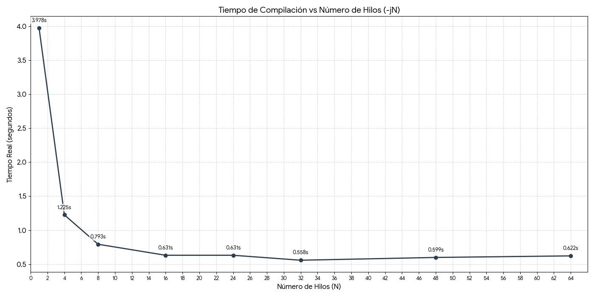

# Entregable 1: Makefiles y ccache

## 1. Análisis de Compilación Multi-hilo (-jN)

**Anotación:** las pruebas se han realizado en Debian 13 como sistema operativo, en un ordenador sobremesa.


Se han realizado pruebas de tiempos de compilación limpia (o clean build) incrementando el número de trabajos en paralelo desde N=1 hasta N=64.

### Tabla de Resultados

| Comando | Tiempo Real | Observaciones |
| :--- | :--- | :--- |
| `make -j1` | **3,978s** | Compilación secuencial (línea base). |
| `make -j4` | **1,225s** | Mejora drástica (~3.2x más rápido). |
| `make -j8` | **0,793s** | Mejora significativa. |
| `make -j16`| **0,631s** | Punto de rendimiento más alto (relación hilos/tiempo). |
| `make -j24`| **0,631s** | El tiempo se estanca. |
| `make -j32`| **0,558s** | Mínima histórica (uso de recursos innecesarios, hilos excesivos). |
| `make -j48`| **0,599s** | Ligero aumento por overhead. |
| `make -j64`| **0,622s** | Saturación en aumento. |



### Respuestas a las cuestiones planteadas

**1. ¿A partir de qué valores de N ya no supone una mejora sustancial el incremento en el número de trabajos en paralelo?**

A partir de N=16, ya que desde ese momento el aprovechamiento de los recursos en relación al tiempo de compilación no es útil.
Como se observa en la tabla y la gráfica, la mejora es muy notable hasta N=8. Al llegar a N=16 el tiempo se estabiliza alrededor de los 0.6 segundos. Aumentar el número de hilos a 32, 48 o 64 produce lo mencionado anteriormente, el uso de los recursos es demasiado alto en relación al aumento mínimo de velocidad de compilación.

**2. ¿Hay fallos de compilación con ejecuciones en paralelo?**
No, no se han producido fallos ni condiciones de carrera (*race conditions*) incluso con N=64.
Esto se debe a que el Makefile ha sido diseñado correctamente:
* Se genera la lista de objetos (.o) de forma dinámica.
* Existe una regla explícita para compilar cada archivo fuente (.cpp) a su objeto (.o) de manera independiente.
* La fase de linkado final espera a que todos los objetos estén listos antes de ejecutarse.

---

## 2. Análisis de Ccache

Se ha configurado la herramienta ccache para optimizar los tiempos de recompilación tras una limpieza del proyecto (make clean).

### Comparativa de Tiempos

Para esta prueba se utilizó make -j16.

| Escenario | Tiempo Real | Descripción |
| :--- | :--- | :--- |
| **Sin ccache** | **0,631s** | Compilación estándar con G++. |
| **Con ccache (Frío)** | **0,742s** | Primera ejecución. Ligeramente más lento por la gestión de caché. |
| **Con ccache (Caliente)**| **0,086s** | Mejora extrema (~8x más rápido que la base). |

### Análisis de Estadísticas

Tras limpiar las estadísticas (ccache -z) y ejecutar dos compilaciones completas (una fría y una caliente), se obtuvieron los siguientes datos:

```text
Cacheable calls:     40 /  42 (95.24%)
  Hits:              20 /  40 (50.00%)
    Direct:          20 /  20 (100.0%)
  Misses:            20 /  40 (50.00%)

Interpretación:

    Total de llamadas (40): Corresponden a los 20 archivos objeto compilados 2 veces.

    Misses (20): Ocurrieron durante la primera compilación (fría). Ccache no tenía los datos y tuvo que llamar al compilador real.

    Hits (20): Ocurrieron durante la segunda compilación (caliente). A pesar de haber hecho un make clean, ccache detectó que el código fuente no había cambiado y recuperó los objetos instantáneamente.

    Hit Rate (50%): Es el resultado matemático correcto de ejecutar el proceso dos veces (0% aciertos la primera vez + 100% aciertos la segunda vez = 50% total).
